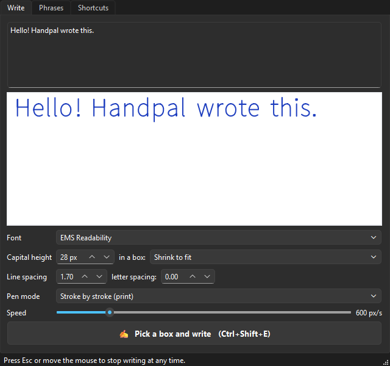
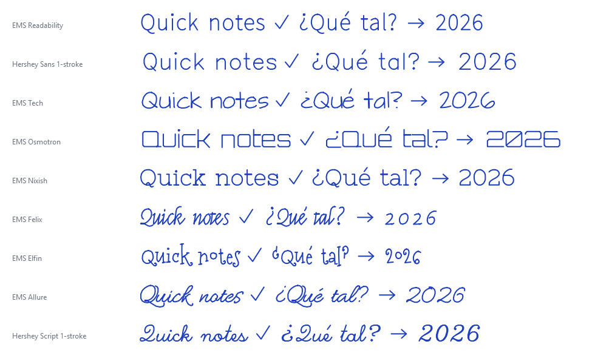

<div align="center">


# Handpal

**Write with your mouse as if by hand.**<br>
Type some text, drag a box on the screen, and Handpal moves the mouse for you —
press, drag, release — drawing every letter in a clean, handwritten-looking font.

[](https://github.com/nicoopal/handpal/actions/workflows/tests.yml)


[](LICENSE)



</div>

---

## Why

Annotating whiteboards, screenshots and documents with a mouse usually ends up looking
like a ransom note. A pen tablet fixes that — until it breaks. Handpal turns your mouse
into a steady hand: you type, it writes. It works in **any app where you draw with the
mouse**: web whiteboards (Miro, Excalidraw, FigJam…), Paint,
PDF annotators, screenshot tools, and so on.

## Features

- ✍️ **Real pen strokes** — uses single-stroke fonts, so letters are drawn as lines, not traced outlines.
- 📦 **Write in a box** — drag a rectangle; the text wraps and shrinks (or grows) to fit.
- 🖱️ **Write at the mouse** — point and press a shortcut; the text starts right there.
- ⚡ **Saved phrases** — bind your usual notes ("Checked ✓", "See comment →") to global shortcuts.
- 🔤 **9 fonts** — clean print, technical and cursive styles, with accents, `ñ`, `¿¡` and handy symbols `✓ ✗ → ← ↑ ↓ •`.
- 🖊️ **Two pen modes** — lift the pen between strokes (print), or keep it down per word (cursive).
- 🌐 **Made for web whiteboards** — slows down on curves and corners so browsers don't cut them (see [How it works](#how-it-works)).
- 🛑 **Always in control** — press <kbd>Esc</kbd> or just move the mouse and it stops instantly.
- 🪟 **Stays out of the way** — lives in the system tray; shortcuts work from any app.

## Installation

Handpal runs on **Windows 10 and 11**.

### Option 1 — Download the app (easiest)

1. Go to [**Releases**](https://github.com/nicoopal/handpal/releases/latest) and download `Handpal-vX.Y.Z-windows.zip`.
2. Unzip it anywhere (for example `C:\Apps\Handpal`).
3. Run **`Handpal.exe`**.

> [!NOTE]
> The executable isn't code-signed, so Windows SmartScreen may warn you the first time.
> Click **More info → Run anyway**. If you prefer, install from source instead (option 2).

### Option 2 — Run from source

Requires [Python 3.10+](https://www.python.org/downloads/) (tick *"Add python.exe to PATH"* when installing) and [Git](https://git-scm.com/download/win).

```bash
git clone https://github.com/nicoopal/handpal.git
cd handpal
Handpal.bat
```

The first run creates a virtual environment and installs the only dependency
([PySide6](https://pypi.org/project/PySide6-Essentials/)). After that, double-click
**`Handpal.bat`** to start it.

### Option 3 — Install with pip

```bash
pip install git+https://github.com/nicoopal/handpal.git
handpal
```

### Start with Windows (optional)

Press <kbd>Win</kbd>+<kbd>R</kbd>, type `shell:startup`, and put a shortcut to
`Handpal.exe` (or `Handpal.bat`) in the folder that opens.

## Quick start

1. Open your whiteboard (or any drawing app) and **select the pen tool**.
2. In Handpal, type your text and pick a font.
3. Click **Pick a box and write**, or press <kbd>Ctrl</kbd>+<kbd>Shift</kbd>+<kbd>E</kbd> from anywhere.
4. Drag a rectangle where the text should go. Hands off the mouse — Handpal writes it.

<p align="center"></p>

## Shortcuts

All shortcuts work system-wide and can be changed in the **Shortcuts** and **Phrases** tabs.

| Shortcut | Action |
|---|---|
| <kbd>Ctrl</kbd>+<kbd>Shift</kbd>+<kbd>E</kbd> | Write the current text in a box you drag |
| <kbd>Ctrl</kbd>+<kbd>Shift</kbd>+<kbd>M</kbd> | Write the current text at the mouse position |
| <kbd>Ctrl</kbd>+<kbd>Shift</kbd>+<kbd>1</kbd> / <kbd>2</kbd> / <kbd>3</kbd> | Write a saved phrase (defaults: "Checked ✓", "See comment →", "OK") |
| <kbd>Esc</kbd> or moving the mouse | Stop writing immediately |
| <kbd>Esc</kbd> or right-click | Cancel while dragging the box |

Closing the window keeps Handpal running in the **system tray** so your shortcuts keep
working. To quit, right-click the tray icon → **Quit**.

> [!TIP]
> Avoid <kbd>Ctrl</kbd>+<kbd>Alt</kbd> shortcuts: on many non-US keyboards that combination
> is <kbd>AltGr</kbd>, and Handpal would swallow characters like `@`, `#` or `|`.

## Saved phrases

In the **Phrases** tab you can add the notes you write all the time. Each phrase has:

- **Text** — can span several lines.
- **Shortcut** — any key combination.
- **Where to write** — *At the mouse* (point and press) or *Pick a box*.
- **Letter height** — its own size, or the default one.

## Settings

| Setting | What it does |
|---|---|
| **Font** | Which single-stroke font to write with. |
| **Capital height** | Height of capital letters, in screen pixels. |
| **In a box** | *Shrink to fit* (default) only makes text smaller when it doesn't fit; *Fixed size* never resizes; *Fill the box* makes the text as big as the box allows. |
| **Line / letter spacing** | Space between lines (× letter height) and extra space between letters. |
| **Pen mode** | *Stroke by stroke* lifts the pen between strokes — right for print. *One line per word* keeps the button down for the whole word — only looks right with cursive fonts. |
| **Speed** | Drawing speed in pixels per second. Lower it if a whiteboard renders angular letters. |

Settings are saved automatically to `%APPDATA%\Handpal\config.json`.

## Fonts



Regular fonts (Arial, Roboto…) store the *outline* of each letter, so tracing them would
draw hollow, double-lined letters. Handpal uses **single-stroke fonts** instead — they
store the path a pen would follow. It ships with the
[Hershey](https://en.wikipedia.org/wiki/Hershey_fonts) and
[EMS](https://gitlab.com/inkscape/extensions/-/tree/master/svg_fonts) fonts from
Inkscape — see [font credits](handpal/fonts/CREDITS.md).

**Add your own:** drop any single-stroke SVG font into `handpal/fonts/` (or
`_internal/handpal/fonts/` in the downloaded app) and restart Handpal.

## How it works

1. **Layout** — the text is laid out with the chosen font, wrapped to the box width and
   scaled to the requested size, producing a list of pen strokes in screen pixels.
2. **Drawing** — for each stroke, Handpal moves the cursor to its start, presses the left
   button, drags along the stroke and releases, using the Windows `SendInput` API, so apps
   see genuine mouse input.
3. **Browser-friendly pacing** — browsers sample the mouse only once per frame (~60 Hz)
   and connect the samples with straight lines, which would cut corners and flatten
   curves. Handpal limits how much the direction changes per frame and briefly holds
   still at sharp corners, so every corner gets sampled.
4. **Safety** — before every step it checks <kbd>Esc</kbd> and whether the cursor is still
   where it put it; if you touch the mouse, it releases the button and stops.

## Troubleshooting

<details>
<summary><b>Nothing gets drawn in a specific app</b></summary>

If the target app runs **as administrator**, Windows blocks input from normal apps.
Run Handpal as administrator too. Also check that the app's pen tool is selected.
</details>

<details>
<summary><b>Letters look angular or corners are cut</b></summary>

Lower the **Speed**. Some web apps process mouse input less often than others.
</details>

<details>
<summary><b>"Shortcut … could not be registered"</b></summary>

Another app (or a second copy of Handpal) already uses that combination. Pick a different one.
</details>

<details>
<summary><b>Clicks land in the wrong place</b></summary>

Handpal works in physical pixels and supports display scaling and multiple monitors.
If you change scaling or plug in a monitor while it's running, restart Handpal.
</details>

<details>
<summary><b>The text doesn't fit in the box</b></summary>

With *Fixed size* the text can overflow — Handpal shows a warning. Use *Shrink to fit*
or drag a bigger box.
</details>

## Development

```bash
git clone https://github.com/nicoopal/handpal.git
cd handpal
python -m venv .venv
.venv\Scripts\activate
pip install -e ".[dev]"

python -m handpal                 # run the app
pytest                            # run the tests
build.bat                         # build dist\Handpal\Handpal.exe
python tools/make_docs_assets.py  # regenerate the README images
```

```
handpal/
├── fonts.py     # parses single-stroke SVG fonts into polylines
├── layout.py    # wraps and scales text into pen strokes (screen pixels)
├── drawer.py    # drives the mouse: press, drag, release, with pacing and safety stops
├── win32.py     # ctypes wrappers: SendInput, cursor, keys, DPI
├── hotkeys.py   # system-wide shortcuts (RegisterHotKey)
├── overlay.py   # full-screen overlay to drag the box
├── ui.py        # main window, tray icon, phrases
├── config.py    # settings stored in %APPDATA%\Handpal
└── fonts/       # bundled single-stroke fonts (see CREDITS.md)
```

**Releasing:** push a tag like `v0.2.0` and the [Release workflow](.github/workflows/release.yml)
builds `Handpal.exe` and publishes it on the Releases page.

## Roadmap

- [ ] Handwriting editor: draw each character once and use **your own handwriting** as a font.
- [ ] Preview of the text inside the box before writing.
- [ ] Per-app profiles (speed, size, font).

## License

[MIT](LICENSE) © Nico Palermo.
The bundled fonts keep their own licenses: the EMS fonts (Sheldon B. Michaels and
Windell H. Oskay, [Evil Mad Scientist](https://www.evilmadscientist.com/)) are under the
[SIL Open Font License 1.1](handpal/fonts/OFL.txt), and the Hershey fonts (Dr. A. V. Hershey)
under the Hershey Fonts license. Details in [CREDITS.md](handpal/fonts/CREDITS.md).
